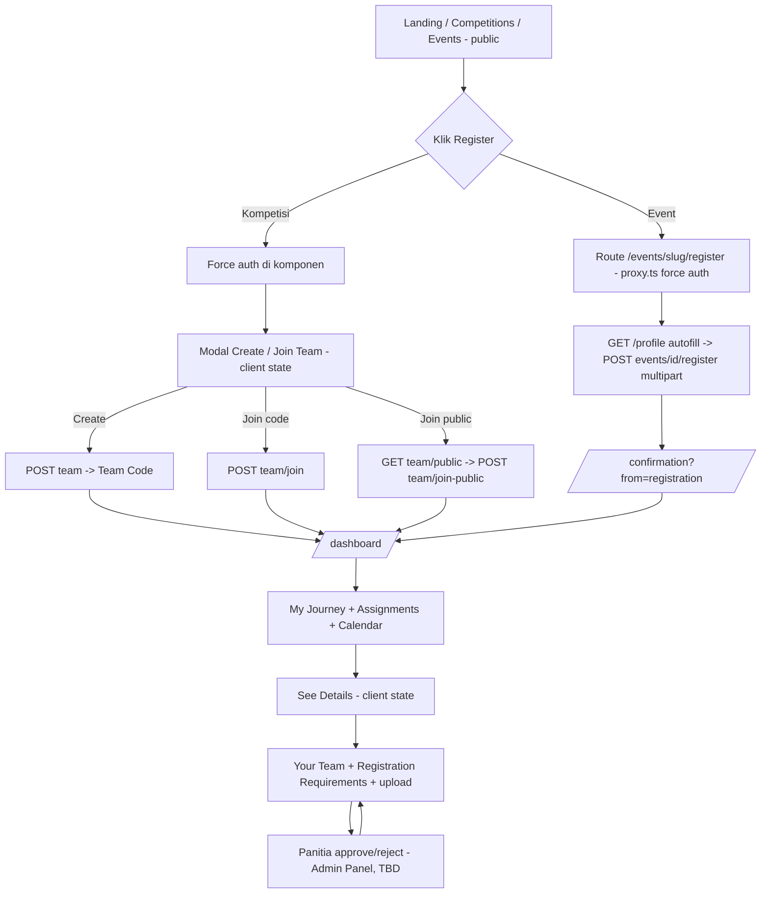
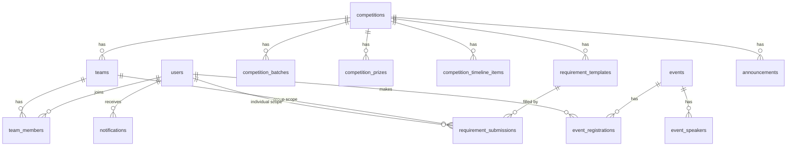

# Backend Implementation Guide — IOE 2027

> Panduan implementasi BE (Cloudflare Workers) untuk website Indonesia Ocean Expo 2027, ditulis dari sudut pandang BE developer.
> Disusun setelah membaca: `PRD_IOE_2027_v4`, `USER_FLOWS_v2 (2)`, `ROUTES (2)`, `API_CONTRACT (2)` (v1.2), `AUTH_IMPLEMENTATION`, `TECHNICAL_CONSTRAINTS_FE (1)`, `ERROR_HANDLING_FE`, `Claude.md`, `CHANGELOG` (di-grep untuk catatan gap), serta kode FE aktual (`src/app/api/**`, `src/lib/*Proxy.ts`, `src/services`, `src/mocks`, `src/types`, form & dashboard components).
>
> **Prinsip dokumen ini:** `API_CONTRACT` tetap sumber kebenaran untuk shape request/response. Hal yang kontrak **tidak** definisikan ditandai **⚠️ Keputusan** dan dikumpulkan di §13 — jangan diam-diam diputuskan sepihak.
>
> Versi file `(2)` diasumsikan lebih baru dari file tanpa suffix (`USER_FLOWS_v2.md` 11 KB tidak punya Cabang C / Public Team, `(2)` 15 KB punya). Konfirmasi kalau asumsi ini salah.

---

## Daftar Isi
1. [Alur pengguna & implikasinya ke BE](#1-alur-pengguna--implikasinya-ke-be)
2. [Arsitektur & stack](#2-arsitektur--stack)
3. [Konvensi global](#3-konvensi-global)
4. [Data model](#4-data-model)
5. [Auth](#5-auth)
6. [Spesifikasi endpoint & business rules](#6-spesifikasi-endpoint--business-rules)
7. [File upload & storage](#7-file-upload--storage)
8. [Data turunan](#8-data-turunan-computed)
9. [Keamanan, konkurensi, performa](#9-keamanan-konkurensi-performa)
10. [Testing, seed, deploy](#10-testing-seed-deploy)
11. [Rencana kerja bertahap](#11-rencana-kerja-bertahap)
12. [Catatan integrasi dengan FE](#12-catatan-integrasi-dengan-fe)
13. [Gap, kontradiksi & pertanyaan terbuka](#13-gap-kontradiksi--pertanyaan-terbuka)
14. [Lampiran: matriks error per endpoint](#14-lampiran-matriks-error-per-endpoint)

---

## 1. Alur pengguna & implikasinya ke BE

### 1.1 Peta besar



### 1.2 Alur → endpoint → aturan BE yang harus dijaga

| # | Alur user | Endpoint yang dipanggil | Aturan BE yang tidak boleh bocor |
|---|---|---|---|
| 1 | Register email | `POST /auth/register` | Email unik (case-insensitive), password di-hash, role selalu `peserta`. `consentPdp` & `confirmPassword` **tidak** dikirim ke BE (FE-only). |
| 2 | Login email | `POST /auth/login` | Error generik `INVALID_CREDENTIALS` (jangan bocorkan email vs password). Akun Google-only tidak punya password → tetap `INVALID_CREDENTIALS`. |
| 3 | Login Google | `POST /auth/google` | Verifikasi `idToken` ke Google (aud, iss, exp, `email_verified`). Email sudah ada → **link akun**, bukan duplikat. Balikkan `isNewUser`. |
| 4 | Session bootstrap / hard refresh | `GET /profile` (dipanggil FE via `/api/auth/me`) | Token invalid/expired → 401 `UNAUTHORIZED` (FE yang clear cookie). Response HARUS cukup untuk `User` (termasuk `avatarUrl`, lihat §12). |
| 5 | Edit profil | `PUT /profile` | `email` tidak bisa diubah. Boleh string kosong (FE `profileSchema` tidak mewajibkan non-empty). |
| 6 | Lihat daftar/detail kompetisi | `GET /competitions`, `GET /competitions/:slug` | Public, tapi kalau ada token valid → isi `isRegisteredByUser`. Slug tak ada → 404 `NOT_FOUND` (FE memanggil `notFound()`). |
| 7 | Klik Register kompetisi → modal | `GET /competitions/:id/team` | **404 = state normal "belum punya tim"**, bukan error. 200 → FE skip modal & redirect `/dashboard`. |
| 8 | Create Team | `POST /competitions/:id/team` | Nama tim **tidak unik**. Generate Team Code unik. `visibility=private`. Pembuat = leader & member pertama. Cek batch masih buka (`REGISTRATION_CLOSED`). 1 user = max 1 tim per kompetisi. |
| 9 | Join via kode | `POST /competitions/:id/team/join` | Kode case-insensitive, hanya cocok di kompetisi yang sama. `TEAM_CODE_INVALID` / `TEAM_FULL`. Cek kapasitas **atomik**. |
| 10 | Join via Public Team | `GET .../team/public` → `POST .../team/join-public` | List hanya `visibility=public` & belum penuh/atau tampilkan penuh dengan `memberCount/maxMember`. Saat join, re-cek `public` (→ `TEAM_NOT_PUBLIC`) dan kapasitas (→ `TEAM_FULL`). |
| 11 | Dashboard | `GET /dashboard/{journey,events,calendar,assignments}` | Semua dihitung dari keanggotaan tim + registrasi event milik user pemanggil. Tidak ada parameter user dari client. |
| 12 | Detail aktivitas | `GET /competitions/:slug` + `GET .../team` + `GET .../requirements` | Individual requirement = milik user pemanggil; group requirement = milik tim. Kepemilikan **selalu** di-resolve BE. |
| 13 | Toggle visibility / remove member | `PATCH .../team/visibility`, `DELETE .../team/members/:userId` | Hanya leader (`NOT_TEAM_LEADER` 403). Remove member → hapus file individual member itu, catat notifikasi. |
| 14 | Upload requirement | `POST .../requirements/:requirementId/upload` | Urutan guard di §6.4. File max 500 KB, format per template, validasi magic bytes. Status → `pending`. |
| 15 | Hapus file | `DELETE .../requirements/:requirementId` | Tidak boleh kalau `accepted` atau lewat deadline. Kembali ke state kosong. |
| 16 | Daftar event | `GET /events`, `GET /events/:slug`, `POST /events/:id/register` | Multipart. 1 registrasi/user/event. Kuota atomik. Email notifikasi fire-and-forget (pending, §6.6). |
| 17 | Panitia review | `PATCH /admin/requirements/...` dll | **Scope TBD** — skema DB disiapkan sekarang, endpoint minimal di Fase 7. |

### 1.3 Hal-hal tidak terlihat jelas dari kontrak tapi menentukan desain BE

1. **FE memakai `competition.id` (bukan slug) untuk semua endpoint `/competitions/:id/team*` dan `/requirements*`**, walau folder route Next.js bernama `[slug]` (`DashboardActivityDetail.tsx`, `useTeam.ts`). Sedangkan `GET /competitions/:slug` memakai slug. → BE: `:id` = id internal. Untuk event, FE belum punya proxy register; **terima id ATAU slug** di `POST /events/:id/register` (resolver helper) supaya aman.
2. **`file.url` dibuka langsung oleh browser** (`<a href target=_blank>`, `<Image src>`), sementara token ada di httpOnly cookie domain FE → URL **tidak bisa** butuh `Authorization` header. Wajib **signed URL berkedaluwarsa** (§7.4).
3. **Satu `requirementId` untuk semua user** di endpoint peserta (`GET .../requirements` mengembalikan item sesuai user pemanggil). Berarti `requirementId` = ID template, dan record "pengerjaan"-nya terpisah per tim/user.
4. **Individual task ada per anggota**; status `verified` tim = agregat semua group + semua individual anggota `accepted`. Harus **dihitung saat baca**, bukan kolom yang bisa drift.
5. **Server-to-server**: semua request ke BE datang dari Next.js server (Cloudflare Pages), bukan browser. Tidak perlu CORS terbuka, dan IP klien yang dilihat BE adalah IP Pages (relevan untuk rate limit, §9).

---

## 2. Arsitektur & stack

Keputusan yang sudah final di dokumen: **Cloudflare Workers** untuk BE, FE di Cloudflare Pages, JWT stateless (7 hari), httpOnly cookie dipasang oleh Next.js (BE tidak `Set-Cookie`), base URL dev `http://localhost:8000/api`.

Yang **belum** diputuskan di dokumen (rekomendasi saya, ⚠️ perlu persetujuan tim):

| Kebutuhan | Rekomendasi | Alasan |
|---|---|---|
| Framework HTTP | **Hono** | Native Workers, middleware, `basePath('/api')`, validator Zod |
| Database | **Cloudflare D1** (SQLite) | Satu ekosistem dengan Workers, murah, cukup untuk target ≤ ~500 peserta. Alternatif: Postgres via Hyperdrive bila perlu transaksi interaktif. |
| ORM / query | **Drizzle ORM** + migrasi SQL | Type-safe, ringan di Workers. Query atomik tetap ditulis SQL manual. |
| Validasi | **Zod** (sama dengan FE) | Shape error `fields` mudah dibentuk |
| JWT | **jose** (HS256) | Jalan di Workers; juga dipakai verifikasi JWKS Google |
| Password hash | **PBKDF2-SHA256, 100.000 iterasi** (WebCrypto) | Runtime Workers membatasi PBKDF2 maks 100.000 iterasi (lebih dari itu `NotSupportedError` di produksi, tapi lolos di `wrangler dev` — jangan tertipu). bcrypt/argon2 tidak native. |
| File storage | **Cloudflare R2** (bucket private) | File tidak boleh publik |
| Rate limit | Workers Rate Limiting binding / KV | §9 |
| Email (F-54) | **Pending** (A3 PRD) | Siapkan interface `Mailer`, implementasi no-op dulu |
| Testing | **Vitest + `@cloudflare/vitest-pool-workers`** | D1/R2 lokal via Miniflare |

> ⚠️ PBKDF2 100k iterasi memakan CPU time per request login/register. **Free plan (CPU 10 ms) kemungkinan tidak cukup** → pakai Workers Paid sebelum go-live, dan uji beban login saat H-1 deadline.

### 2.1 Repo & struktur folder (repo BE terpisah dari repo FE ini)

```
ioe2027-be/
  wrangler.jsonc
  drizzle.config.ts
  package.json
  migrations/                  # SQL, dibuat oleh drizzle-kit, di-apply wrangler d1 migrations
  seed/
    seed.sql                   # kompetisi, batch, template requirement, event (id sama dengan mock FE)
    create-admin.ts            # buat user panitia manual
  src/
    index.ts                   # export default { fetch, scheduled }
    app.ts                     # Hono app, basePath('/api'), mount routes + middleware
    env.ts                     # type Bindings & Variables
    middleware/
      requestId.ts
      errorHandler.ts          # AppError / ZodError -> format kontrak
      auth.ts                  # requireAuth, optionalAuth, requireRole('panitia')
      rateLimit.ts
    lib/
      errors.ts                # class AppError(code, status), katalog ERROR_CODES
      response.ts              # ok(), created(), fail()
      validate.ts              # zod -> VALIDATION_ERROR { fields }
      time.ts                  # toWib(iso), now()
      ids.ts                   # ulid(), generateTeamCode()
      password.ts              # PBKDF2
      jwt.ts                   # sign/verify
      google.ts                # verifyGoogleIdToken
      files.ts                 # validateFile (size, ext, mime, magic), r2 key builder
      signedUrl.ts             # HMAC sign/verify
      resolve.ts               # resolveCompetition(idOrSlug), resolveEvent(idOrSlug)
    db/
      schema.ts                # drizzle
      queries/                 # query kompleks (team status, assignments, calendar)
    modules/
      auth/        routes.ts service.ts schemas.ts
      profile/
      competitions/
      teams/
      requirements/
      events/
      dashboard/
      files/                   # GET /files/* (signed)
      admin/                   # Fase 7
    jobs/
      cleanupOrphans.ts        # scheduled
  test/
```

### 2.2 `wrangler.jsonc` (kerangka)

```jsonc
{
  "name": "ioe2027-api",
  "main": "src/index.ts",
  "compatibility_date": "2026-10-01",
  "compatibility_flags": ["nodejs_compat"],
  "d1_databases": [{ "binding": "DB", "database_name": "ioe2027", "database_id": "<isi>", "migrations_dir": "migrations" }],
  "r2_buckets":   [{ "binding": "FILES", "bucket_name": "ioe2027-files" }],
  "triggers": { "crons": ["0 20 * * *"] },       // cleanup orphan 03:00 WIB
  "vars": { "JWT_TTL_SECONDS": "604800", "FILE_URL_TTL_SECONDS": "3600", "APP_TZ": "Asia/Jakarta" }
  // secrets (wrangler secret put): JWT_SECRET, GOOGLE_CLIENT_ID, FILE_SIGNING_SECRET
}
```

Dev: `wrangler dev --port 8000` + `app.basePath('/api')` → `http://localhost:8000/api` sesuai `.env.local.example` FE.

Staging & production `WORKERS_API_URL` baru terisi saat deploy (A2) — tidak blocking.

---

## 3. Konvensi global

### 3.1 Response

```ts
// sukses
{ success: true, data: T, message?: string }
// error
{ success: false, error: { code: string, message: string } }
// VALIDATION_ERROR saja:
{ success: false, error: { code: "VALIDATION_ERROR", message: "Ada isian yang belum sesuai, cek lagi ya",
    fields: { email: "Format email tidak valid", password: "Password minimal 8 karakter" } } }
```

- `fields`: **semua** field gagal sekaligus; key = nama field body persis (camelCase). Hanya ada untuk `VALIDATION_ERROR`.
- `message` selalu bahasa Indonesia dari katalog error (§14), supaya konsisten dengan `ERROR_MESSAGES` di FE.
- Status: 200 GET/PUT/PATCH/DELETE, 201 POST yang membuat resource, 400/401/403/404/500 sesuai tabel kontrak.
- Respons personal (ada token) → `Cache-Control: private, no-store`. Katalog publik tanpa token boleh `public, max-age=60`.

### 3.2 Pola implementasi error

```ts
export class AppError extends Error {
  constructor(public code: ErrorCode, public status: number, message?: string, public fields?: Record<string,string>) { super(message ?? ERROR_CATALOG[code].message) }
}
// middleware/errorHandler.ts: AppError -> fail(); ZodError -> VALIDATION_ERROR+fields; selainnya -> log + SERVER_ERROR 500 (jangan bocorkan stack).
```

Validasi Zod → `fields`: ambil **issue pertama per path**; path nested digabung dengan `.`; pesan Indonesia per rule.

### 3.3 Waktu

- Simpan UTC (`TEXT` ISO-8601 `...Z` atau epoch ms — pilih satu, saya sarankan ISO `Z` agar mudah dibaca di D1 console).
- **Output selalu ISO-8601 dengan offset `+07:00`** (`2027-08-07T14:00:00+07:00`) lewat helper `toWib()`.
- Jangan pakai `new Date()` mentah untuk perbandingan deadline — satu helper `now()` supaya bisa di-mock di test.

### 3.4 ID

ULID/nanoid `TEXT` (prefix opsional `usr_`, `team_`, `sub_`). ID seed kompetisi/event **disamakan dengan mock FE** (`comp-business-case`, `comp-paper-poster`, `comp-design`, `event-talkshow`, `event-workshop`, `event-short-course`, `event-exhibition`) supaya switch dari mock ke BE tidak mengubah apa pun di FE.

### 3.5 CORS & header

Tidak ada pemanggilan dari browser ke BE (kecuali `GET /files/*` via signed URL — itu ``/`<a>`, bukan fetch/XHR, jadi tanpa CORS). Jangan aktifkan CORS wildcard. Selalu kirim `X-Content-Type-Options: nosniff`.

---

## 4. Data model



### 4.1 DDL (SQLite/D1)

```sql
-- USERS
CREATE TABLE users (
  id            TEXT PRIMARY KEY,
  email         TEXT NOT NULL UNIQUE COLLATE NOCASE,
  name          TEXT NOT NULL,
  password_hash TEXT,                       -- NULL untuk akun Google-only
  google_sub    TEXT UNIQUE,
  role          TEXT NOT NULL DEFAULT 'peserta' CHECK (role IN ('peserta','panitia')),
  avatar_url    TEXT,
  institution   TEXT, phone TEXT, domicile TEXT,
  created_at    TEXT NOT NULL, updated_at TEXT NOT NULL
);

-- KOMPETISI
CREATE TABLE competitions (
  id TEXT PRIMARY KEY, slug TEXT NOT NULL UNIQUE, name TEXT NOT NULL,
  description TEXT NOT NULL DEFAULT '', guidebook_url TEXT, logo_url TEXT,
  total_prize_pool_idr INTEGER,
  max_team_members INTEGER NOT NULL DEFAULT 5,    -- ⚠️ asumsi dari mock FE, konfirmasi klien
  is_published INTEGER NOT NULL DEFAULT 1,
  created_at TEXT NOT NULL
);
CREATE TABLE competition_batches (
  id TEXT PRIMARY KEY, competition_id TEXT NOT NULL REFERENCES competitions(id),
  name TEXT NOT NULL,                              -- "Batch 1"
  opens_at TEXT NOT NULL, closes_at TEXT NOT NULL, sort_order INTEGER NOT NULL DEFAULT 0
);
CREATE TABLE competition_prizes (
  id TEXT PRIMARY KEY, competition_id TEXT NOT NULL REFERENCES competitions(id),
  label TEXT NOT NULL, amount_idr INTEGER NOT NULL, sort_order INTEGER NOT NULL      -- 0 = juara 1
);
CREATE TABLE competition_timeline_items (
  id TEXT PRIMARY KEY, competition_id TEXT NOT NULL REFERENCES competitions(id),
  label TEXT NOT NULL, occurs_at TEXT NOT NULL,
  show_in_calendar INTEGER NOT NULL DEFAULT 1, sort_order INTEGER NOT NULL DEFAULT 0
);

-- TIM
CREATE TABLE teams (
  id TEXT PRIMARY KEY,
  competition_id TEXT NOT NULL REFERENCES competitions(id),
  batch_id TEXT NOT NULL REFERENCES competition_batches(id),
  name TEXT NOT NULL,                              -- TIDAK unik
  code TEXT NOT NULL UNIQUE,                       -- AAA-1111, ^[A-Z]{3}-[A-Z0-9]{4}$
  visibility TEXT NOT NULL DEFAULT 'private' CHECK (visibility IN ('private','public')),
  leader_user_id TEXT NOT NULL REFERENCES users(id),
  created_at TEXT NOT NULL
);
CREATE TABLE team_members (
  team_id TEXT NOT NULL REFERENCES teams(id) ON DELETE CASCADE,
  user_id TEXT NOT NULL REFERENCES users(id),
  competition_id TEXT NOT NULL REFERENCES competitions(id),   -- denormalisasi utk constraint
  role TEXT NOT NULL CHECK (role IN ('leader','member')),
  joined_at TEXT NOT NULL,
  PRIMARY KEY (team_id, user_id),
  UNIQUE (competition_id, user_id)                 -- 1 user = max 1 tim per kompetisi
);
CREATE INDEX idx_teams_comp_vis ON teams(competition_id, visibility);

-- REGISTRATION REQUIREMENTS
CREATE TABLE requirement_templates (
  id TEXT PRIMARY KEY, competition_id TEXT NOT NULL REFERENCES competitions(id),
  name TEXT NOT NULL, type TEXT NOT NULL CHECK (type IN ('group','individual')),
  due_at TEXT NOT NULL, instructions TEXT NOT NULL DEFAULT '',
  accepted_formats TEXT NOT NULL DEFAULT '["jpg","png"]',      -- JSON array
  sort_order INTEGER NOT NULL DEFAULT 0
);
CREATE TABLE requirement_submissions (
  id TEXT PRIMARY KEY,
  template_id TEXT NOT NULL REFERENCES requirement_templates(id),
  team_id TEXT REFERENCES teams(id) ON DELETE CASCADE,         -- diisi utk group
  user_id TEXT REFERENCES users(id),                           -- diisi utk individual (pemilik); utk group = uploader terakhir (audit)
  status TEXT NOT NULL DEFAULT 'pending' CHECK (status IN ('pending','accepted','rejected')),
  file_key TEXT, file_name TEXT, file_size INTEGER, file_mime TEXT,
  rejection_reason TEXT,
  submitted_at TEXT, reviewed_by TEXT REFERENCES users(id), reviewed_at TEXT,
  updated_at TEXT NOT NULL
);
CREATE UNIQUE INDEX uq_sub_group      ON requirement_submissions(template_id, team_id) WHERE team_id IS NOT NULL;
CREATE UNIQUE INDEX uq_sub_individual ON requirement_submissions(template_id, user_id) WHERE team_id IS NULL;

-- EVENT
CREATE TABLE events (
  id TEXT PRIMARY KEY, slug TEXT NOT NULL UNIQUE, name TEXT NOT NULL,
  description TEXT NOT NULL DEFAULT '',
  starts_at TEXT, registration_closes_at TEXT NOT NULL,
  quota INTEGER,                                   -- NULL = tak terbatas
  is_paid INTEGER NOT NULL DEFAULT 0, price_idr INTEGER,
  is_published INTEGER NOT NULL DEFAULT 1, created_at TEXT NOT NULL
);
CREATE TABLE event_speakers (
  id TEXT PRIMARY KEY, event_id TEXT NOT NULL REFERENCES events(id),
  name TEXT NOT NULL, session_at TEXT, sort_order INTEGER NOT NULL DEFAULT 0
);
CREATE TABLE event_registrations (
  id TEXT PRIMARY KEY,
  event_id TEXT NOT NULL REFERENCES events(id), user_id TEXT NOT NULL REFERENCES users(id),
  session_type TEXT NOT NULL CHECK (session_type IN ('seminar','workshop')),
  speaker_id TEXT REFERENCES event_speakers(id),
  phone TEXT NOT NULL, line_id TEXT, institution TEXT NOT NULL, domicile TEXT NOT NULL,
  cv_key TEXT, payment_proof_key TEXT,
  created_at TEXT NOT NULL,
  UNIQUE (event_id, user_id)
);

-- PENDUKUNG
CREATE TABLE notifications (          -- minimal: "Kamu Bukan Lagi Bagian dari Grup [Nama Tim]"
  id TEXT PRIMARY KEY, user_id TEXT NOT NULL REFERENCES users(id),
  type TEXT NOT NULL, payload TEXT NOT NULL, read_at TEXT, created_at TEXT NOT NULL
);
CREATE TABLE announcements (          -- widget Announcement; endpoint belum ada di kontrak
  id TEXT PRIMARY KEY, competition_id TEXT REFERENCES competitions(id),
  body TEXT NOT NULL, created_by TEXT NOT NULL REFERENCES users(id), created_at TEXT NOT NULL
);
```

### 4.2 Catatan desain

- **Template vs submission** — template = definisi tetap per kompetisi (5 item standar + proposal bila ada). Submission dibuat **lazy** saat pertama upload (GET gabungkan `LEFT JOIN`; tidak ada submission = `status:'pending'`, `file:null`). Tidak perlu materialisasi saat user join tim.
- **Status `verified` tim tidak disimpan** — dihitung (§8.1).
- **`student_id`** di `Team.members` tidak jadi kolom — lihat ⚠️ Q7.
- **Batch**: `deadline` di `CompetitionSummary` = penutupan batch aktif (§8.4). `Team.batch` = nama batch saat tim dibuat.
- Harga/hadiah disimpan integer IDR; BE memformat ke string `"Rp 10.000.000"` (FE memakai string apa adanya).

---

## 5. Auth

### 5.1 JWT

- HS256, secret `JWT_SECRET` (min 32 byte acak).
- Claims: `sub` (user id), `role`, `iat`, `exp = iat + 7 hari` — **sama dengan `maxAge` cookie FE** (A1/A4 sudah dinyatakan clear).
- Stateless (A3: tanpa blocklist). Konsekuensi: user yang di-demote dari `panitia` tetap bisa hit admin sampai token habis → **endpoint `/admin/*` wajib cek role ke DB**, bukan hanya claim.
- Respons sukses auth: `{ token, user }` di body; **jangan `Set-Cookie`**.

### 5.2 Middleware

```ts
requireAuth   // Bearer wajib; invalid/expired/missing -> 401 UNAUTHORIZED
optionalAuth  // token valid -> c.set('user'); invalid -> perlakukan anonim (JANGAN 401) — dipakai GET /competitions*, GET /events*
requireRole('panitia') // DB lookup role; bukan panitia -> 403 ADMIN_ONLY
```

### 5.3 Register

1. Validasi: `name` trim 2–100; `email` format + lowercase; `password` ≥ 8, mengandung huruf **dan** angka (aturan FE `registerSchema`, yang di dokumen disebut asumsi — BE harus minimal sama keras; cap atas 128).
2. Email sudah ada (apa pun metode) → `400 EMAIL_ALREADY_REGISTERED`.
3. Hash PBKDF2 → insert → JWT → `201 { token, user }`.

Format hash tersimpan: `pbkdf2$sha256$100000$<salt_b64>$<hash_b64>` (versi & iterasi ikut tersimpan agar bisa di-upgrade).

### 5.4 Login

- Cari user by email (NOCASE). Jika tidak ada / `password_hash IS NULL` → tetap jalankan hash dummy (samakan waktu) → `401 INVALID_CREDENTIALS`.
- Bandingkan hash **constant-time**.
- `200 { token, user }`.

### 5.5 Google

```ts
const JWKS = createRemoteJWKSet(new URL('https://www.googleapis.com/oauth2/v3/certs'));
const { payload } = await jwtVerify(idToken, JWKS, {
  issuer: ['https://accounts.google.com', 'accounts.google.com'],
  audience: env.GOOGLE_CLIENT_ID,
});
if (!payload.email_verified) throw new AppError('INVALID_CREDENTIALS', 401);
```

- Cari by `google_sub`; kalau tidak ada cari by email → **link** (isi `google_sub`, `avatar_url` bila kosong) ; kalau tidak ada → buat user baru (`password_hash` NULL, `isNewUser:true`).
- Scope data dibatasi nama, email, foto (NFR UU PDP).
- `avatarUrl` disegarkan tiap login; `name` hanya diisi saat user dibuat (jangan menimpa nama yang sudah diedit user di My Profile — ⚠️ Q12 kecil).
- `idToken` invalid/expired → `401 INVALID_CREDENTIALS` (kontrak tidak menyebut code khusus Google; ⚠️ Q13).
- **Blocker**: `GOOGLE_CLIENT_ID` belum diterima dari klien (A2 AUTH). Bangun dengan env var; test dengan token mock di Miniflare.

### 5.6 Profile

- `GET /profile` → `User` lengkap **termasuk `avatarUrl`** (kontrak daftar field tidak menyebutnya, tapi FE `/api/auth/me` memakai respons ini sebagai `User`; tanpa `avatarUrl` Navbar/Sidebar tidak dapat foto Google — F-03, F-46).
- `PUT /profile` body `{name, institution, phone, domicile}`, `.strict()` di sisi FE. BE: trim; `name` wajib non-empty (user tanpa nama tidak masuk akal); tiga field lain boleh `""` → simpan `NULL`. Ada key `email`/`role` di body → **abaikan** (jangan error, jangan proses). Balikkan data profil terbaru.
- Panjang maks: name 100, institution 150, phone 30, domicile 100. Tidak ada validasi pola telepon (kontrak tidak mendefinisikan).

---

## 6. Spesifikasi endpoint & business rules

Semua path di bawah `/api`. "Auth": **R**=wajib, **O**=opsional, **–**=tidak.

| Method | Path | Auth | Fase |
|---|---|---|---|
| POST | `/auth/register` | – | 1 |
| POST | `/auth/login` | – | 1 |
| POST | `/auth/google` | – | 1 |
| GET | `/profile` | R | 1 |
| PUT | `/profile` | R | 1 |
| GET | `/competitions` | O | 2 |
| GET | `/competitions/:slug` | O | 2 |
| GET | `/events` | O | 2 |
| GET | `/events/:slug` | O | 2 |
| GET | `/competitions/:id/team` | R | 3 |
| POST | `/competitions/:id/team` | R | 3 |
| POST | `/competitions/:id/team/join` | R | 3 |
| GET | `/competitions/:id/team/public` | R | 3 |
| POST | `/competitions/:id/team/join-public` | R | 3 |
| PATCH | `/competitions/:id/team/visibility` | R (leader) | 3 |
| DELETE | `/competitions/:id/team/members/:userId` | R (leader) | 3 |
| GET | `/competitions/:id/requirements` | R | 4 |
| POST | `/competitions/:id/requirements/:requirementId/upload` | R | 4 |
| DELETE | `/competitions/:id/requirements/:requirementId` | R | 4 |
| GET | `/files/*` *(baru, signed)* | signature | 4 |
| GET | `/dashboard/journey` | R | 5 |
| GET | `/dashboard/events` | R | 5 |
| GET | `/dashboard/calendar` | R | 5 |
| GET | `/dashboard/assignments` | R | 5 |
| POST | `/events/:id/register` | R | 6 |
| *`/admin/*`* | | R (panitia) | 7 |

### 6.1 Competitions (publik)

**`GET /competitions`** → `CompetitionSummary[]`: `{id, slug, name, deadline, isRegisteredByUser}`.
- Hanya `is_published=1`. Urut `sort`/nama stabil.
- `deadline` = §8.4. `isRegisteredByUser` = user (kalau token valid) member tim di kompetisi itu, else `false`.

**`GET /competitions/:slug`** → detail sesuai tipe FE `CompetitionDetail` (`src/types/competition.ts`):

```json
{ "id","slug","name","deadline","isRegisteredByUser",
  "description": "string",
  "timeline": [ { "date": "ISO8601", "label": "string" } ],
  "totalPrizePool": "Rp 20.000.000",
  "prizeBreakdown": [ { "label": "Juara 1", "amount": "Rp 10.000.000" } ],
  "guidebookUrl": "string | null" }
```
- Slug tidak ada / tidak published → `404 NOT_FOUND`.
- `timeline` urut `occurs_at`. ⚠️ **FE saat ini merender `item.date` mentah** (mock berisi `"17 Jan 2027"`). Kontrak mewajibkan ISO → BE kirim ISO, **FE harus memformat** (§12). Jangan kirim string terformat demi menambal FE.
- `prizeBreakdown` urut `sort_order`; `totalPrizePool` dari kolom, fallback jumlah prize.

### 6.2 Team

Resolver: `competitionId` dari path → 404 `NOT_FOUND` jika tidak ada. Dapatkan `Team` penuh lewat satu fungsi `loadTeamForUser(competitionId, userId)` (dipakai GET, create, join, visibility).

**Shape `Team`** (sesuai kontrak, `isLeader` relatif ke pemanggil):
```json
{ "teamId","teamName","teamCode","batch","status":"verified|pending","visibility",
  "isLeader", "leader":{"id","name"}, "members":[{"id","name","studentId"}] }
```
Semua response yang mengembalikan tim (**termasuk 201 create** — kontrak hanya menyebut subset 5 field; mengembalikan superset kompatibel dengan tipe FE yang field-nya opsional) memakai shape penuh.

**`GET /competitions/:id/team`**
- Punya tim → 200 `Team`. Belum → **404 `NOT_FOUND`** (FE: `status 404 → null`). Wajib status 404 persis.

**`POST /competitions/:id/team`** `{teamName}`
- Validasi: trim, 1–80 karakter. **Tidak ada cek unik.**
- Urutan: kompetisi ada → batch aktif ada, kalau tidak `400 REGISTRATION_CLOSED` → user belum punya tim di kompetisi ini, kalau sudah `400 ALREADY_IN_TEAM` *(code baru, §13 Q4)* → buat team + member leader dalam **satu `db.batch([...])`** → `201`.
- Team Code: 3 huruf + `-` + 4 alfanumerik, alfabet tanpa `I`/`O` (mengikuti `generateTeamCode()` di mock FE), `crypto.getRandomValues`. Retry maks 5× bila `UNIQUE` bentrok.

**`POST /competitions/:id/team/join`** `{teamCode}`
- Normalisasi `toUpperCase().trim()`. Cari `teams WHERE code=? AND competition_id=?` — tidak ketemu → `400 TEAM_CODE_INVALID` (kode dari kompetisi lain pun invalid).
- Sudah punya tim di kompetisi ini → `400 ALREADY_IN_TEAM`.
- Batch tim sudah tutup → `400 REGISTRATION_CLOSED` ⚠️ (kontrak hanya menyebut untuk create; USER_FLOWS "form disabled kalau deadline lewat" — saya terapkan juga di join; Q5).
- Insert atomik dengan cek kapasitas (satu statement):
  ```sql
  INSERT INTO team_members (team_id,user_id,competition_id,role,joined_at)
  SELECT ?1, ?2, ?3, 'member', ?4
  WHERE (SELECT COUNT(*) FROM team_members WHERE team_id = ?1)
        < (SELECT max_team_members FROM competitions WHERE id = ?3);
  ```
  `meta.changes === 0` → `400 TEAM_FULL`. Pelanggaran `UNIQUE(competition_id,user_id)` → `ALREADY_IN_TEAM`.
- 200 `Team` dengan `isLeader:false`.

**`GET /competitions/:id/team/public`**
- `teams WHERE competition_id=? AND visibility='public'` → `{teamId, teamName, memberCount, maxMember}`; `[]` bila kosong. `maxMember = competitions.max_team_members`.
- Sembunyikan tim yang user itu sendiri sudah menjadi member-nya (ia sudah punya tim, tidak relevan). Tim penuh: **tetap tampil** (FE menangani `TEAM_FULL` dari join-public, `memberCount/maxMember` tersedia untuk ditampilkan) ⚠️ Q6.

**`POST /competitions/:id/team/join-public`** `{teamId}`
- Tim tidak ada/ bukan di kompetisi ini/ `visibility != 'public'` → `400 TEAM_NOT_PUBLIC`. Lalu aturan sama dengan join code (penuh → `TEAM_FULL`, sudah punya tim → `ALREADY_IN_TEAM`).

**`PATCH /competitions/:id/team/visibility`** `{visibility: 'private'|'public'}`
- Pemanggil harus member tim di kompetisi ini; bukan leader → `403 NOT_TEAM_LEADER`. Bukan member sama sekali → `404 NOT_FOUND`.
- Nilai selain enum → `VALIDATION_ERROR` `fields.visibility`. Respons `{visibility}`.

**`DELETE /competitions/:id/team/members/:userId`**
- Hanya leader (`NOT_TEAM_LEADER`). Target bukan member tim itu → `404 NOT_FOUND`. Target = leader sendiri → `400 VALIDATION_ERROR` (`fields.userId`) — leader tidak bisa mengeluarkan dirinya (⚠️ Q8: tidak ada flow "leave team"/transfer leader di dokumen).
- Dalam satu batch: hapus `team_members`; hapus semua `requirement_submissions` **individual** milik target di kompetisi itu (+ hapus objek R2 setelahnya); insert `notifications(type='removed_from_team', payload={teamName, competitionId})`.
- Group submission tetap milik tim. `200 { message: "Member berhasil dihapus" }` (data boleh null).
- Efek di dashboard target (logo + activity hilang) otomatis karena journey dihitung dari `team_members`.

### 6.3 Requirements — baca

**`GET /competitions/:id/requirements`** (R)
- User bukan member tim kompetisi ini → `404 NOT_FOUND` ⚠️ Q9.
- Untuk tiap template urut `sort_order`:
  - group → submission by `(template_id, team_id)`; individual → by `(template_id, user_id=caller)`.
  - Tidak ada submission → `{status:'pending', file:null, rejectionReason:null}`.
- Shape per kontrak `RequirementItem`: `{requirementId (=template.id), name, type, status, dueDate (WIB), instructions, rejectionReason, acceptedFormats[], file:{url (signed), fileName}|null}`.
- `rejectionReason` hanya terisi saat `status='rejected'`.

### 6.4 Requirements — upload & delete

**`POST .../requirements/:requirementId/upload`** (multipart, field `file`)

Urutan guard (mengikuti mock FE `requirementProxy.ts` agar perilaku identik):

```
1. requireAuth
2. competition ada (404)            ─ template ada & milik kompetisi ini (404 NOT_FOUND)
3. caller member tim kompetisi ini (404 NOT_FOUND)
4. now >= template.due_at           → 400 DEADLINE_PASSED      ← apa pun statusnya (termasuk accepted); file lama TIDAK dihapus
5. submission.status == 'accepted'  → 400 REQUIREMENT_LOCKED
6. Content-Length > 512000 + overhead multipart → 400 FILE_TOO_LARGE (sebelum parse body)
7. parse multipart; field `file` tidak ada → 400 VALIDATION_ERROR fields.file
8. file.size > 512000               → FILE_TOO_LARGE
9. ekstensi ∈ acceptedFormats, mime cocok, magic bytes cocok → else 400 INVALID_FILE_FORMAT
10. put R2 (key baru) → upsert submission (status='pending', rejection_reason=NULL, file_*=baru, submitted_at=now)
11. hapus objek R2 lama (best effort, setelah DB sukses)
12. 200 RequirementItem terbaru
```

- Batas = `500 * 1024 = 512000` byte (sama dengan FE `MAX_DOCUMENT_BYTES`; **tepat 512000 diterima**).
- Group requirement: **anggota tim mana pun** boleh upload (USER_FLOWS: "biasanya leader") ⚠️ Q10.
- Untuk requirement `rejected`: file lama sudah dihapus saat reject, jadi upload langsung diterima.

**`DELETE .../requirements/:requirementId`**
- Guard sama (4) deadline → `DEADLINE_PASSED`, (5) `accepted` → `REQUIREMENT_LOCKED`.
- Hapus objek R2; submission: `status='pending'`, kolom `file_*` & `rejection_reason` = NULL.
- Respons `200` dengan `RequirementItem` kosong (FE hanya memeriksa `success`). Tidak ada submission → idempotent 200.

### 6.5 Dashboard

Semuanya R. Definisi turunan ada di §8.

| Endpoint | Item |
|---|---|
| `GET /dashboard/journey` | `{competitionId, slug, name, logoUrl, status:'in_progress'\|'complete', dueDate}` untuk tiap kompetisi tempat user jadi member |
| `GET /dashboard/events` | `{eventId, slug, name, sessionType, date}` untuk tiap `event_registrations` user. `date` = `speaker.session_at` bila ada, else `events.starts_at` |
| `GET /dashboard/calendar` | `{date, label, type:'competition'\|'event', refId, logoUrl}` gabungan; urut `date` asc |
| `GET /dashboard/assignments` | `{requirementId, competitionSlug, competitionName, name, type, status, dueDate, acceptedFormats}`; default `status=pending`, dukung `?status=pending\|accepted\|rejected\|all` |

### 6.6 Events

**`GET /events`** → `{id, slug, name, deadline, isRegisteredByUser}`; `deadline = registration_closes_at`. (Kontrak `EventSummary` juga menyebut `speakers[]`; sertakan di list hanya jika murah — wajib di detail.)

**`GET /events/:slug`** → `EventSummary` + `speakers:[{id,name}]`. FE zod hanya mewajibkan `id, slug, name, deadline, isRegisteredByUser`, `speakers` opsional dan **key tak dikenal diabaikan**, jadi aman menambahkan (usulan, Q11): `description`, `startsAt`, `isPaid`, `priceIdr`, `quota`, `registeredCount`, `registrationOpen`, `speakers[].sessionAt`. Kontrak belum mendefinisikan benefit/timeline/rundown/lokasi → jangan mengarang; tunggu keputusan.

**`POST /events/:id/register`** (R, `multipart/form-data`)

Fields: `sessionType` (`seminar|workshop`), `speakerId?`, `phone`, `lineId?`, `institution`, `domicile`, `cvFile?`, `paymentProof?`.

Validasi (kumpulkan semua error → `VALIDATION_ERROR.fields`):
- `phone`, `institution`, `domicile` wajib non-empty (PRD §7 bertanda `*`); `lineId` opsional.
- `sessionType=workshop` & event punya >1 speaker → `speakerId` wajib & harus milik event itu. `seminar` → `speakerId` diabaikan/NULL.
- `cvFile`: **PDF saja**, ≤ 500 KB. `paymentProof`: wajib bila `events.is_paid`; format JPG/PNG ⚠️ Q14 (kontrak tidak menyebut format).

Guard bisnis (urutan): event ada (id **atau** slug) → `now > registration_closes_at` → `400 REGISTRATION_CLOSED` → user sudah terdaftar → `400 ALREADY_REGISTERED` *(code baru, Q4; FE saat ini hanya menampilkan "Sudah Terdaftar" dari `isRegisteredByUser`)* → kuota atomik:

```sql
INSERT INTO event_registrations (...)
SELECT ... WHERE (SELECT quota FROM events WHERE id=?1) IS NULL
   OR (SELECT COUNT(*) FROM event_registrations WHERE event_id=?1) < (SELECT quota FROM events WHERE id=?1);
-- changes = 0 -> 400 QUOTA_FULL
```

Upload file ke R2 **sebelum** insert, hapus kembali bila insert gagal (+ job orphan cleanup).

`201 { registrationId }`. Setelah respons: `c.executionCtx.waitUntil(mailer.sendRegistrationEmail(...).catch(log))` — **fire-and-forget**, kegagalan email tidak me-rollback (USER_FLOWS). Layanan email belum diputuskan (A3/A4) → `Mailer` no-op dulu.
- Profile **tidak** ditulis balik (auto-fill FE hanya default; submission independen).

### 6.7 Admin (Fase 7 — minimal, scope final TBD)

Semua: `requireAuth` + `requireRole('panitia')` (cek DB) → `403 ADMIN_ONLY`.

| Endpoint (kandidat kontrak §3.6) | Catatan |
|---|---|
| `GET /admin/registrations` | List tim + anggota + status per requirement, & registrasi event; filter `competitionId`, `eventId`, `status`; paginasi |
| `GET /admin/registrations/export?format=csv\|xlsx` | Mulai dengan CSV (streaming). xlsx menyusul. |
| `PATCH /admin/requirements/:id` `{status:'accepted'\|'rejected', reason?}` | `reason` wajib bila `rejected`. **Reject** ⇒ hapus objek R2, `file_*=NULL`, simpan `rejection_reason`, `status='rejected'`, catat `reviewed_by/at`. **Accept** ⇒ `status='accepted'`, `rejection_reason=NULL`. |
| `POST /admin/announcements` | Tulis ke `announcements` |

⚠️ **`:requirementId` di admin ambigu**: untuk peserta itu ID *template* (sama untuk semua user), sedangkan admin perlu menunjuk submission spesifik (tim/user tertentu). Saran: endpoint admin memakai **`submissionId`** (`PATCH /admin/submissions/:submissionId`). Perlu persetujuan karena menyimpang dari nama di kontrak (Q3).

Pembuatan akun panitia: tidak ada endpoint publik; lewat `seed/create-admin.ts` / SQL manual.

---

## 7. File upload & storage

### 7.1 Aturan (sumber: API_CONTRACT §File Upload Convention + PRD F-20)

| Konteks | Format | Max | Field |
|---|---|---|---|
| 5 requirement standar (Payment Proof, Identity Card, Passport Photo, Active Student Status Letter, Twibbon/Poster Proof) | JPG, PNG | 500 KB | `file` |
| Proposal/karya kompetisi (bila ada template-nya) | PDF, JPG, PNG | 500 KB | `file` |
| CV registrasi event | PDF | 500 KB | `cvFile` |
| Bukti bayar event | ⚠️ JPG/PNG (belum didefinisikan) | 500 KB | `paymentProof` |

Format diambil dari `requirement_templates.accepted_formats` (default `["jpg","png"]`) — jangan hardcode di handler.

### 7.2 Validasi file (`lib/files.ts`)

```ts
const MAX = 500 * 1024;
const MIME = { jpg:'image/jpeg', jpeg:'image/jpeg', png:'image/png', pdf:'application/pdf' };
function sniff(buf: Uint8Array): 'jpg'|'png'|'pdf'|null {
  if (buf[0]===0xFF && buf[1]===0xD8 && buf[2]===0xFF) return 'jpg';
  if (buf[0]===0x89 && buf[1]===0x50 && buf[2]===0x4E && buf[3]===0x47) return 'png';
  if (buf[0]===0x25 && buf[1]===0x50 && buf[2]===0x44 && buf[3]===0x46) return 'pdf'; // %PDF
  return null;
}
// cek berurutan: size -> FILE_TOO_LARGE; ext ∈ allowed && file.type === MIME[ext] && sniff === ext(norm) -> else INVALID_FILE_FORMAT
```

FE hanya cek ekstensi + MIME; BE **wajib** cek magic bytes (klien bisa dimanipulasi).

### 7.3 Penyimpanan

- Bucket R2 **private**. Key dibuat BE, **bukan** dari nama file klien:
  `submissions/{competitionId}/{submissionId}/{ulid}.{ext}`, `events/{eventId}/{registrationId}/cv-{ulid}.pdf`, dst.
- Simpan `file_name` asli (disanitasi: buang path/kontrol karakter, potong 120 char) hanya untuk tampilan.
- Reject/delete/replace/remove-member ⇒ hapus objek R2 yang lama. Cron `jobs/cleanupOrphans.ts` menyapu objek R2 tanpa referensi DB lebih dari 24 jam.

### 7.4 Akses file — signed URL (penting)

Browser membuka `file.url` langsung → tidak ada header Bearer. Solusi:

- `file.url = https://<worker-host>/api/files/<key>?exp=<epoch>&sig=<hmac>`
  - `sig = HMAC-SHA256(FILE_SIGNING_SECRET, key + '.' + exp)` (base64url), `exp` = now + `FILE_URL_TTL_SECONDS` (default 3600).
- `GET /files/*`: verifikasi `exp` & `sig` (constant-time) → stream dari R2. Header: `Content-Type` dari object, `Content-Disposition: inline`, `X-Content-Type-Options: nosniff`, `Cache-Control: private, max-age=300`.
- Karena URL kedaluwarsa dan FE meng-cache data (TanStack `staleTime`), TTL ≥ 1 jam dan FE me-refetch saat buka detail aktivitas. (Q15)
- Endpoint ini **tidak ada di kontrak** → tambahkan ke API_CONTRACT (usulan v1.3, §13).

---

## 8. Data turunan (computed)

### 8.1 `Team.status`
```
verified ⇔ ada ≥1 template group AND setiap template group punya submission team berstatus accepted
        AND untuk SETIAP member, setiap template individual punya submission accepted
else pending
```
Hitung dalam satu query agregat (LEFT JOIN + `COUNT`); jangan N+1.

### 8.2 `Journey.status`
Kontrak hanya menyebut `in_progress|complete` tanpa definisi. Usulan: `complete` ⇔ semua template group (milik tim) **dan** semua template individual milik user tersebut berstatus `accepted`; selain itu `in_progress`. ⚠️ Q2.
`dueDate` = deadline kompetisi (§8.4) — sama dengan mock FE.

### 8.3 Assignments
Untuk tiap kompetisi user: semua template × (submission sesuai scope) → status efektif `coalesce(sub.status,'pending')` → filter. Kontrak: "default `pending`" — berarti item yang **sudah diupload & menunggu review** juga ikut muncul sebagai to-do, dan item `rejected` (butuh upload ulang) justru tidak. ⚠️ Q1 (lihat §13); default saya ikuti kontrak literal sampai diputuskan, sambil menyediakan param `status`.

### 8.4 Deadline kompetisi & registrasi terbuka
```
batch aktif   = batch dengan opens_at <= now < closes_at
deadline      = closes_at batch aktif
              ?? opens_at-terdekat batch berikutnya.closes_at      -- belum buka
              ?? closes_at batch terakhir                            -- sudah tutup
registrationOpen = ada batch aktif
```

### 8.5 Calendar
```
union:
 A. competition_timeline_items (show_in_calendar=1) untuk kompetisi tempat user member
    label = "<Nama Kompetisi> — <label item>", type='competition', refId=competitionId, logoUrl=competition.logo_url
 B. event_registrations user → date = speaker.session_at ?? event.starts_at (skip jika NULL),
    label = "<Nama Event>[ — <speaker>]", type='event', refId=eventId, logoUrl=null
order by date asc
```
Tanpa filter rentang (data memang hanya s.d. Mei 2027). Semua tanggal output WIB (NFR "Data Accuracy").

---

## 9. Keamanan, konkurensi, performa

### 9.1 Keamanan
- Semua query **parameterized** (Drizzle / `prepare().bind()`), tidak ada interpolasi string SQL.
- **Authorization di tiap resource**: tim/requirement/registrasi selalu di-scope ke `user.id` dari JWT, tidak pernah dari body/query. Uji IDOR: user A tidak bisa baca/ubah submission/tim user B walau menebak ID.
- Password: PBKDF2 (§5), compare constant-time, error login generik.
- Rate limit (Workers Rate Limiting binding / KV): `POST /auth/login`, `/auth/register`, `/auth/google`, upload, `team/join` (cegah brute-force Team Code — ruang kode ±24³·32⁴ besar tapi tetap batasi). ⚠️ Karena semua traffic datang dari Pages, **kunci limit per email + per user, bukan hanya IP**. (HTTP 429 `RATE_LIMITED` belum ada di kontrak — Q4.)
- Jangan log password/token/idToken/isi file. `request-id` di tiap log.
- Header `X-Content-Type-Options: nosniff`; file tidak pernah disajikan lewat domain yang sama dengan app cookie (Worker domain terpisah dari FE — sudah begitu).
- UU PDP: data minimal; consent checkbox FE-only (keputusan A6). Pertimbangkan prosedur hapus data user (tidak ada di scope).
- Secrets lewat `wrangler secret`, tidak di `vars`/repo.

### 9.2 Konkurensi (D1 tidak punya transaksi interaktif)
- Gunakan `db.batch([...])` untuk multi-statement atomik.
- **Kapasitas tim & kuota event**: `INSERT ... SELECT ... WHERE count < max` + cek `meta.changes` (§6.2, §6.6) — bukan `SELECT` lalu `INSERT`.
- Constraint di DB sebagai pagar terakhir: `UNIQUE(competition_id,user_id)`, `UNIQUE(event_id,user_id)`, `UNIQUE(code)`, unique index submission. Tangkap error constraint → map ke error code (`ALREADY_IN_TEAM`, `ALREADY_REGISTERED`, retry kode).
- Upload: DB dulu atau R2 dulu? → R2 dulu, DB kemudian, hapus R2 lama setelah DB sukses; sisa orphan disapu cron.

### 9.3 Performa & traffic spike H-1 deadline
- Target PRD: uptime ≥ 99%, error submit < 1%. Workers scale otomatis; **bottleneck = D1 write** & CPU PBKDF2.
- Index sesuai DDL; `GET /competitions*` & `/events*` (anon) cache `public, max-age=60` (+ `waitUntil` cache API opsional).
- Hindari N+1 di dashboard & status tim (satu query agregat per endpoint).
- Load test sebelum launch: login burst, create/join team, upload (k6/autocannon ke `wrangler dev` atau staging).

---

## 10. Testing, seed, deploy

### 10.1 Testing
- **Contract tests**: tiap endpoint dites terhadap shape di `API_CONTRACT` (Zod schema response dipakai di test — idealnya dibagi dengan FE `types/`).
- **Wajib ada test skenario**:
  - Auth: duplikat email (beda huruf besar), Google link akun, token expired → 401, role panitia ke endpoint admin → ok, peserta → `ADMIN_ONLY`.
  - Team: nama sama boleh; join kode salah/kode kompetisi lain; penuh (race: 2 join bersamaan slot terakhir → hanya 1 sukses); public→private di tengah jalan (`TEAM_NOT_PUBLIC`); non-leader toggle/remove (`NOT_TEAM_LEADER`); `GET team` 404 saat belum punya.
  - Requirement: tepat 512000 byte lolos, 512001 → `FILE_TOO_LARGE`; ekstensi `.png` isi PDF → `INVALID_FILE_FORMAT`; `accepted` → `REQUIREMENT_LOCKED`; lewat `due_at` + `pending` → `DEADLINE_PASSED` & file lama tetap; **accepted + lewat deadline → `DEADLINE_PASSED`** (urutan guard); reject → file terhapus & upload ulang langsung bisa; individual milik user lain tidak terlihat.
  - Remove member: individual submission & file member hilang, group tetap, notifikasi tercatat.
  - Event register: kuota atomik, double register, workshop tanpa `speakerId`, CV bukan PDF, event berbayar tanpa `paymentProof`, email gagal tidak membatalkan 201.
  - `VALIDATION_ERROR.fields` memuat **semua** field salah, key camelCase persis.
  - Waktu: semua output ber-offset `+07:00`; `now()` di-mock untuk deadline.
- Gunakan `@cloudflare/vitest-pool-workers` (D1/R2 asli di Miniflare), migrasi dijalankan di `beforeAll`.

### 10.2 Seed
`seed/seed.sql` meniru mock FE (id/slug sama) + batch, timeline, prize, 5 template requirement per kompetisi (Payment Proof = `group`, 4 lainnya `individual`, `accepted_formats=["jpg","png"]`, `due_at` = deadline batch), 4 event. **Teks instruksi pembayaran & nomor rekening nyata belum ada** (kontennya dari klien) — isi placeholder, jangan mengarang rekening.

### 10.3 Deploy
`wrangler d1 migrations apply` → `wrangler deploy`. Staging dulu (isi `WORKERS_API_URL` staging di Pages), smoke test dengan FE nyata (login → create team → upload → dashboard), lalu production. Rollback: `wrangler rollback`; migrasi **forward-only & backward-compatible** (tambah kolom nullable dulu).

---

## 11. Rencana kerja bertahap

| Fase | Isi | Definition of Done | Blocker |
|---|---|---|---|
| 0 | Repo, Hono, D1/R2 lokal, error/response/validate util, CI (lint+test) | `GET /api/health` 200, test jalan | Keputusan stack (§2) |
| 1 | Auth + Profile | Register/login/google/profile lolos contract test; FE `/api/auth/me` bekerja; `avatarUrl` ada | `GOOGLE_CLIENT_ID` (Google bisa dites mock) |
| 2 | Katalog kompetisi & event (read) + seed | `/competitions*`, `/events*` bentuk sama dengan mock FE | Konten final dari klien (pakai placeholder) |
| 3 | Team (6 endpoint) | Semua alur Cabang A/B/C + toggle + remove lolos test, race kapasitas lolos | `max_team_members` final (Q-asumsi 5) |
| 4 | Requirements + file + signed URL | Guard order §6.4 lolos; file bisa dibuka dari browser FE | Instruksi pembayaran asli |
| 5 | Dashboard (4 endpoint) | FE dashboard memakai BE tanpa mock | Q1, Q2 diputuskan |
| 6 | Event register | Multipart, kuota atomik, `Mailer` no-op | Q11, Q14; email (A3 — **pending**) |
| 7 | Admin minimal (approve/reject, list, export csv, announcement) | Reject menghapus file + alasan tampil di FE | **Requirement gathering admin (A4/A5 — pending)**; Q3 |
| 8 | Hardening: rate limit, load test, observability, staging→prod | Lolos load test H-1 profile; secrets terpasang | Plan Workers Paid, base URL staging/prod |
| 9 | Email konfirmasi (F-54) | `Mailer` nyata | Pilihan layanan email (A3) |

Fase 3→4→5 saling bergantung; Fase 7 boleh paralel setelah Fase 4 karena tabel sudah siap, tapi tanpa admin **tidak ada cara mengubah status `accepted`/`rejected`** — minimal PATCH review harus ada sebelum UAT.

---

## 12. Catatan integrasi dengan FE

Hal yang saya temukan di kode FE yang memengaruhi BE (bukan tugas BE, tapi harus dikomunikasikan):

| # | Temuan di FE | Dampak | Usulan |
|---|---|---|---|
| F1 | `src/app/api/competitions/route.ts` & `[slug]/route.ts` memanggil `fetchWorkers("/competitions")` **tanpa token** (beda dengan `eventProxy` yang meneruskan token). | `isRegisteredByUser` selalu `false`. | FE: teruskan token cookie seperti `eventProxy`. BE: sudah mendukung `optionalAuth`. |
| F2 | `CompetitionDetailTimelineSection` merender `item.date` mentah; mock berisi `"17 Jan 2027"`. | BE (ISO sesuai kontrak) akan tampil sebagai `2027-01-17T…` | FE: format dengan `formatWibDate(item.date)`. |
| F3 | `file.url` dipakai langsung `<a href>`/`<Image>`. | Butuh signed URL (§7.4). | Selaraskan; tambah `GET /files/*` ke kontrak. |
| F4 | Semua endpoint team/requirements dipanggil dengan **`competition.id`**; route Next bernama `[slug]`. | Nama membingungkan; BE `:id` = id. | Dokumentasikan; BE tetap strict di id untuk kompetisi. |
| F5 | Proxy `POST /api/events/[slug]/register` belum ada; form masih disabled. FE `fetchWorkers` memaksa `Content-Type: application/json` dan `JSON.stringify` body. | Multipart register tidak bisa lewat helper itu. | FE: proxy multipart seperti `requirementProxy` (tanpa set Content-Type manual). BE: terima id **atau** slug. |
| F6 | `src/app/api/auth/*/route.ts` tidak membungkus `fetchWorkers` dengan try/catch (BE down/non-JSON → 500 mentah Next). | UX buruk saat BE mati. | FE: bungkus; BE: selalu balas JSON (jangan HTML error page dari Worker). |
| F7 | `/api/auth/me` memetakan `GET /profile` ke tipe `User` (ada `avatarUrl`). | Kontrak `GET /profile` tidak menyebut `avatarUrl`. | BE sertakan `avatarUrl` (§5.6); update kontrak. |
| F8 | `profileSchema` FE mengizinkan string kosong. | `PUT /profile` bisa menerima `""`. | BE normalisasi `""`→NULL (§5.6). |
| F9 | `fetchMyTeam` memperlakukan **HTTP 404** = belum punya tim. | Jangan ganti ke 200+null atau 204. | BE patuh (§6.2). |
| F10 | FE membuat `Content-Length`/ukuran file sendiri; upload via `FormData` field `file`. | — | BE cek ukuran sendiri (tidak percaya FE). |

---

## 13. Gap, kontradiksi & pertanyaan terbuka

Per aturan `Claude.md` (#2, #3): kontradiksi/gap dilaporkan, bukan diputuskan diam-diam. Kolom **Default** = yang saya implementasikan sementara bila belum ada keputusan.

| # | Pertanyaan / Gap | Lokasi | Default sementara | Putuskan oleh |
|---|---|---|---|---|
| **Q1** | **Definisi "pending" di Assignments.** `pending` dipakai untuk "belum upload" **dan** "sudah upload menunggu review". Filter default `pending` memunculkan item yang sudah diupload sebagai to-do, dan menyembunyikan `rejected` yang justru butuh aksi. | API_CONTRACT §3.5, `RequirementItem` | Literal kontrak (`status=pending`) + param `?status=`. Alternatif: to-do = `file IS NULL` (pending-kosong + rejected). | Tim FE+BE+PM |
| **Q2** | Definisi `Journey.status` `complete` & sumber `dueDate`. | §3.5 | Lihat §8.2 | PM |
| **Q3** | Admin `PATCH /admin/requirements/:requirementId` ambigu (template vs submission). | §3.6 | Pakai `submissionId` | Tim BE+FE |
| **Q4** | **Error code baru** yang dibutuhkan agar tidak ada jalur bisu: `ALREADY_IN_TEAM` (create/join saat sudah punya tim, mis. race/direct call), `ALREADY_REGISTERED` (event), opsional `RATE_LIMITED` (429). Harus masuk `API_CONTRACT` + `ERROR_HANDLING_FE` + `errorMessages.ts`; kalau FE belum tahu → fallback `SERVER_ERROR`. | FONDASI 4/4 | Implement; fallback FE sudah ada | Tim FE+BE |
| **Q5** | `REGISTRATION_CLOSED` juga untuk join (kontrak hanya create). | §Error Code Reference | Berlaku di create + join + join-public | PM |
| **Q6** | Public list: tampilkan tim penuh atau sembunyikan? | §3.2 | Tampilkan (dengan `memberCount/maxMember`) | Desain+FE |
| **Q7** | **`Team.members[].studentId`** (A7): "jangan dihapus — buat menandai user ID lain yang sudah join". Sumber nilainya tidak jelas (tidak ada field NIM di Profile/form). | Data Models `Team` | Isi dengan `user.id` anggota (string non-null). Tanya: apakah maksudnya NIM? Jika ya perlu field profil baru (kontrak profil melarang tambahan). | Tim BE + PM |
| **Q8** | Tidak ada flow **leave team** untuk member, **transfer leader**, atau leader meninggalkan tim. | USER_FLOWS | Tidak diimplementasi; leader tidak bisa remove diri sendiri | PM |
| **Q9** | `GET requirements` bagi user yang belum punya tim: kode apa? | §3.3 | `404 NOT_FOUND` | Tim FE |
| **Q10** | Group requirement boleh diupload anggota mana pun atau leader saja? | USER_FLOWS ("biasanya leader") | Anggota mana pun | PM |
| **Q11** | **Shape detail event** belum didefinisikan (description, benefit, timeline, rundown, lokasi, harga, kuota, kapasitas per speaker, batch). FE sendiri mencatat ini sebagai gap. | `EventSummary`, CHANGELOG | Tambah field opsional (§6.6), jangan mengarang konten | Klien + FE + BE |
| **Q12** | Nama user dari Google: timpa saat login berikutnya atau hanya saat dibuat? (F-46 "otomatis dari Google") | Auth | Hanya saat dibuat; avatar disegarkan | PM |
| **Q13** | Error code untuk `idToken` Google invalid (tidak ada di tabel). | §3.1 | `INVALID_CREDENTIALS` 401 | Tim FE+BE |
| **Q14** | Format file `paymentProof` event berbayar tidak didefinisikan (hanya `cvFile` PDF). Event mana yang berbayar & harganya juga belum ada. | §File Upload | JPG/PNG | Klien |
| **Q15** | TTL signed URL vs cache FE. | §7.4 | 1 jam | Tim FE+BE |
| **Q16** | **Notifikasi "Kamu Bukan Lagi Bagian dari Grup [Nama Tim]"** disebut di USER_FLOWS, tapi tidak ada endpoint/UI notifikasi di kontrak; "notifikasi/reminder" juga Out of Scope PRD. | USER_FLOWS Edge Cases vs PRD §4.2 | Simpan di tabel `notifications`, tanpa endpoint | PM |
| **Q17** | **Endpoint Announcements** (widget di detail aktivitas) tidak ada di kontrak; hanya `POST /admin/announcements`. | USER_FLOWS vs API_CONTRACT | Tabel siap, endpoint GET menunggu | Tim FE+BE |
| **Q18** | `max_team_members` (mock = 5), min anggota, apakah semua kompetisi berbasis tim (USER_FLOWS: "asumsi"). Kontrak punya `maxMember` hanya di list public. | Mock FE | 5, semua team-based | Klien |
| **Q19** | Format Team Code `AAA-1111` adalah asumsi FE (kontrak hanya `string`). | `teamSchemas.ts` | Ikuti FE; BE generate sesuai pola itu | PM |
| **Q20** | Aturan password (min 8 + huruf + angka) hanya asumsi FE. | `features/auth/schemas.ts` | BE menegakkan yang sama | Klien |
| **Q21** | DB (D1 vs lain), plan Workers Paid, layanan email, domain Worker. | — | §2 | Tim |
| **Q22** | Konten/instruksi pembayaran & nomor rekening dengan "kode unik" ditambahkan ke nominal (USER_FLOWS) → artinya BE harus **mengalokasikan kode unik** per tim? Tidak ada spesifikasi. | USER_FLOWS Detail Isi Requirement | Hanya `instructions` statis | Klien + PM |
| **Q23** | `ADMIN_ONLY` redirect vs 403 page (FE A3) — tidak memengaruhi BE (selalu 403). | ERROR_HANDLING_FE | — | FE |
| **Q24** | Dokumen duplikat `(2)` vs tanpa suffix (ROUTES, USER_FLOWS, API_CONTRACT) | repo `amunisi/` | `(2)` dianggap terbaru | PM |

### Usulan perubahan kontrak (calon API_CONTRACT v1.3)
1. Tambah `GET /files/*` (signed, tanpa Bearer) — §7.4.
2. `GET /profile` & respons auth: tulis eksplisit `User` penuh termasuk `avatarUrl`.
3. `POST /competitions/:id/team` 201 mengembalikan `Team` penuh (superset).
4. Error code baru: `ALREADY_IN_TEAM`, `ALREADY_REGISTERED` (opsional `RATE_LIMITED` + 429).
5. `GET /dashboard/assignments?status=` didokumentasikan.
6. Definisikan `EventDetail` (Q11) & endpoint announcements (Q17).
7. `timeline[].date` ditegaskan ISO 8601 (FE yang memformat).
8. Admin memakai `submissionId` (Q3).

> Sesuai `Claude.md` aturan #3: begitu perubahan di atas disetujui, **update `API_CONTRACT.md` dan `ERROR_HANDLING_FE.md` secara manual** dan catat di `CHANGELOG.md`. Dokumen ini sendiri hanya usulan.

---

## 14. Lampiran: matriks error per endpoint

Katalog (pesan = persis seperti `ERROR_HANDLING_FE`/`errorMessages.ts`):

| Code | HTTP | Pesan |
|---|---|---|
| `VALIDATION_ERROR` | 400 | Ada isian yang belum sesuai, cek lagi ya (+`fields`) |
| `EMAIL_ALREADY_REGISTERED` | 400 | Email ini sudah terdaftar, coba login |
| `INVALID_CREDENTIALS` | 401 | Email atau password salah |
| `UNAUTHORIZED` | 401 | Sesi berakhir, silakan login lagi |
| `NOT_TEAM_LEADER` | 403 | Hanya ketua tim yang bisa melakukan ini |
| `ADMIN_ONLY` | 403 | Kamu tidak punya akses ke halaman ini |
| `TEAM_CODE_INVALID` | 400 | Kode tim tidak ditemukan, cek lagi kodenya |
| `TEAM_FULL` | 400 | Tim ini sudah penuh |
| `TEAM_NOT_PUBLIC` | 400 | Tim ini tidak lagi membuka pendaftaran publik |
| `REGISTRATION_CLOSED` | 400 | Pendaftaran untuk batch ini sudah ditutup |
| `QUOTA_FULL` | 400 | Kuota sudah penuh |
| `FILE_TOO_LARGE` | 400 | Ukuran file melebihi 500 KB |
| `INVALID_FILE_FORMAT` | 400 | Format file tidak sesuai |
| `REQUIREMENT_LOCKED` | 400 | Dokumen ini sudah disetujui dan tidak bisa diubah lagi |
| `DEADLINE_PASSED` | 400 | Batas waktu sudah berakhir. File yang sudah kamu kirim tetap tersimpan, tapi tidak bisa diunggah ulang |
| `NOT_FOUND` | 404 | Data tidak ditemukan |
| `SERVER_ERROR` | 500 | Terjadi kesalahan, coba lagi nanti |
| *`ALREADY_IN_TEAM`* (usulan) | 400 | Kamu sudah tergabung di tim untuk kompetisi ini |
| *`ALREADY_REGISTERED`* (usulan) | 400 | Kamu sudah terdaftar di event ini |

Endpoint → kemungkinan error:

| Endpoint | Error yang mungkin |
|---|---|
| `POST /auth/register` | `VALIDATION_ERROR`, `EMAIL_ALREADY_REGISTERED` |
| `POST /auth/login` | `VALIDATION_ERROR`, `INVALID_CREDENTIALS` |
| `POST /auth/google` | `VALIDATION_ERROR`, `INVALID_CREDENTIALS` (Q13) |
| `GET/PUT /profile` | `UNAUTHORIZED`, `VALIDATION_ERROR` |
| `GET /competitions`, `/events` | — |
| `GET /competitions/:slug`, `/events/:slug` | `NOT_FOUND` |
| `GET /competitions/:id/team` | `UNAUTHORIZED`, `NOT_FOUND` (=belum punya tim / kompetisi tak ada) |
| `POST /competitions/:id/team` | `UNAUTHORIZED`, `VALIDATION_ERROR`, `NOT_FOUND`, `REGISTRATION_CLOSED`, `ALREADY_IN_TEAM` |
| `POST .../team/join` | `UNAUTHORIZED`, `VALIDATION_ERROR`, `TEAM_CODE_INVALID`, `TEAM_FULL`, `REGISTRATION_CLOSED`, `ALREADY_IN_TEAM` |
| `GET .../team/public` | `UNAUTHORIZED`, `NOT_FOUND` |
| `POST .../team/join-public` | `UNAUTHORIZED`, `VALIDATION_ERROR`, `TEAM_NOT_PUBLIC`, `TEAM_FULL`, `ALREADY_IN_TEAM` |
| `PATCH .../team/visibility` | `UNAUTHORIZED`, `VALIDATION_ERROR`, `NOT_TEAM_LEADER`, `NOT_FOUND` |
| `DELETE .../team/members/:userId` | `UNAUTHORIZED`, `NOT_TEAM_LEADER`, `NOT_FOUND`, `VALIDATION_ERROR` (hapus diri) |
| `GET .../requirements` | `UNAUTHORIZED`, `NOT_FOUND` |
| `POST .../requirements/:id/upload` | `UNAUTHORIZED`, `NOT_FOUND`, `DEADLINE_PASSED`, `REQUIREMENT_LOCKED`, `FILE_TOO_LARGE`, `INVALID_FILE_FORMAT`, `VALIDATION_ERROR` |
| `DELETE .../requirements/:id` | `UNAUTHORIZED`, `NOT_FOUND`, `DEADLINE_PASSED`, `REQUIREMENT_LOCKED` |
| `GET /dashboard/*` | `UNAUTHORIZED` |
| `POST /events/:id/register` | `UNAUTHORIZED`, `NOT_FOUND`, `VALIDATION_ERROR`, `REGISTRATION_CLOSED`, `QUOTA_FULL`, `FILE_TOO_LARGE`, `INVALID_FILE_FORMAT`, `ALREADY_REGISTERED` |
| `/admin/*` | `UNAUTHORIZED`, `ADMIN_ONLY`, `VALIDATION_ERROR`, `NOT_FOUND` |
| Semua | `SERVER_ERROR` |
